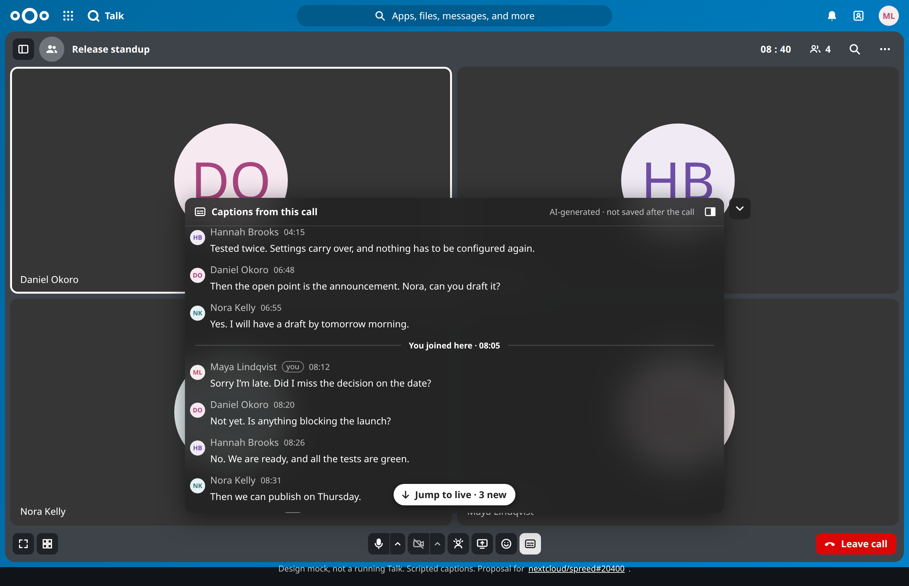

# Caption history in Talk: design mock

A clickable mock of one way to read earlier live captions in Nextcloud Talk: the existing caption box opens upwards into the call's caption history, and closes again.

It accompanies the feature request [nextcloud/spreed#20400](https://github.com/nextcloud/spreed/issues/20400).

**Live page:** https://codemyriad.github.io/talk-caption-history-mock/

## What to try

- The button beside the caption box opens and closes the history. Esc closes it too.
- Scroll up to read back. The box stops following, and "Jump to live" returns to the newest line.
- The participants button in the top bar opens Talk's sidebar. The captions stay over the call.
- The pin button in the history's header docks the captions beside the video, so nobody is covered.

## Still states, for screenshots

Add these to the address:

| Address ends with | Shows |
| --- | --- |
| `?start=history` | History open |
| `?start=scrolled` | Scrolled back to before the viewer joined |
| `?start=pinned` | Captions pinned to the side |
| `&sidebar=1` | Talk's sidebar open |
| `&animate=0` | Captions frozen |

## What this is not

This is not a running Talk. It is one HTML file with scripted captions and no connection to any server. Sizes and colours of the caption box follow Talk's `LiveTranscriptionRenderer.vue` and `TranscriptBlock.vue`.

Made by [Codemyriad](https://codemyriad.io) with AI assistance (Claude Code). Licensed AGPL-3.0-or-later, like Talk.
